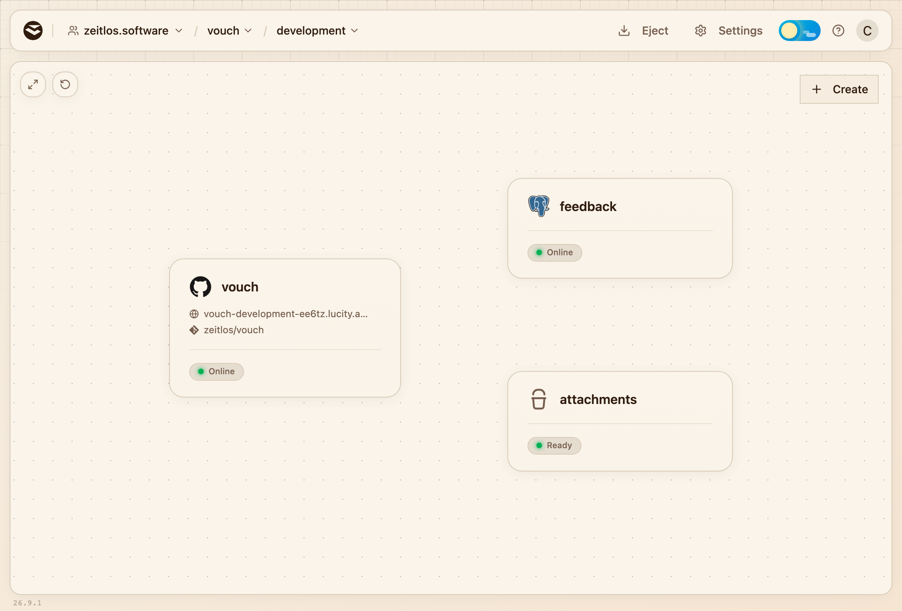
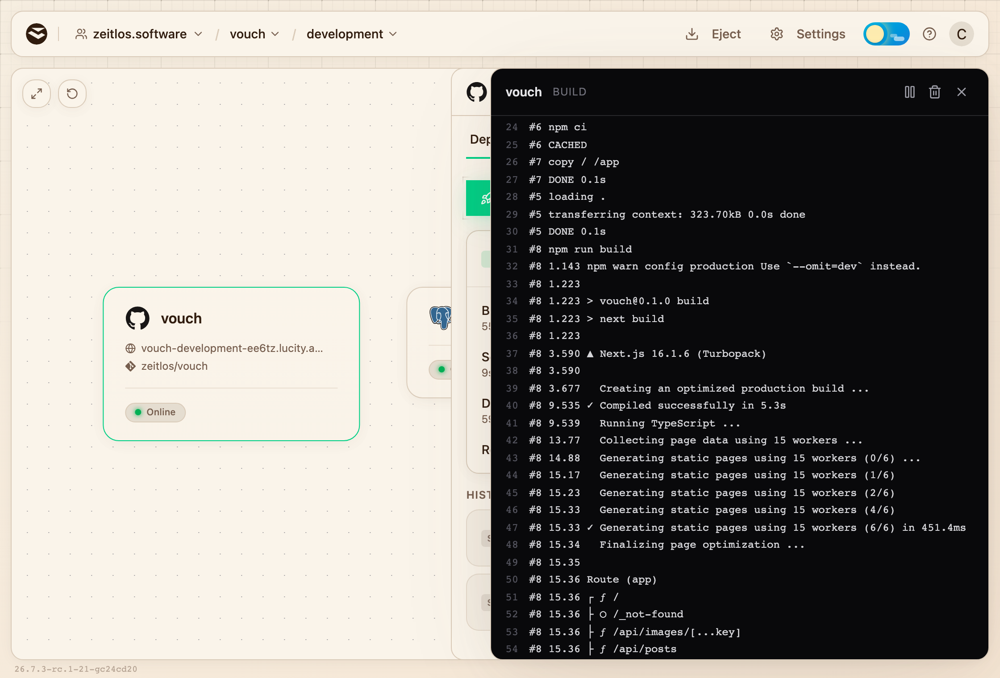
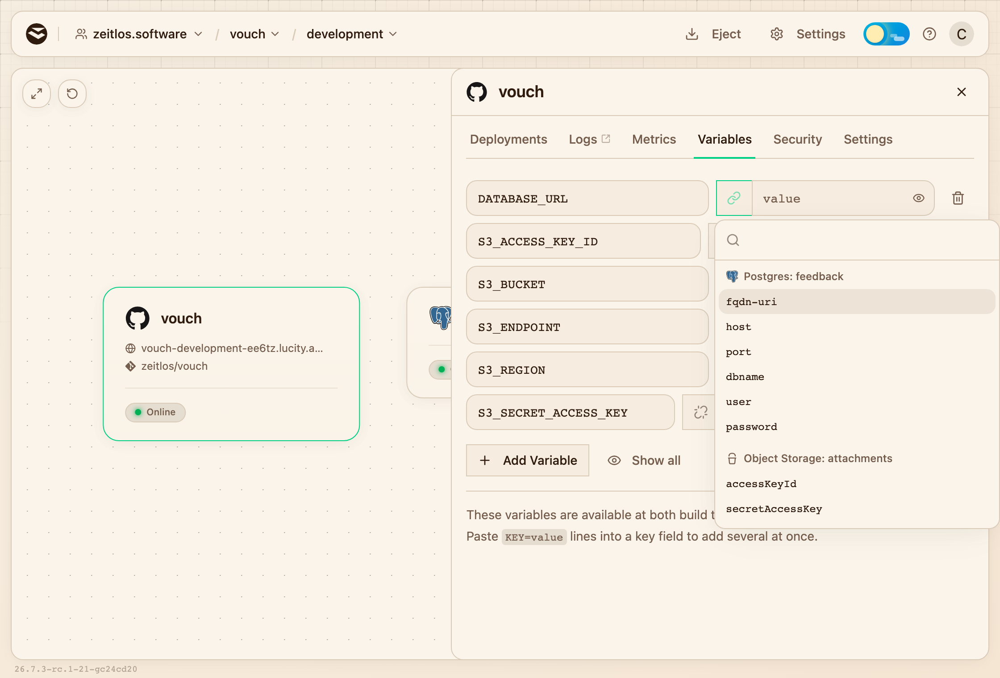
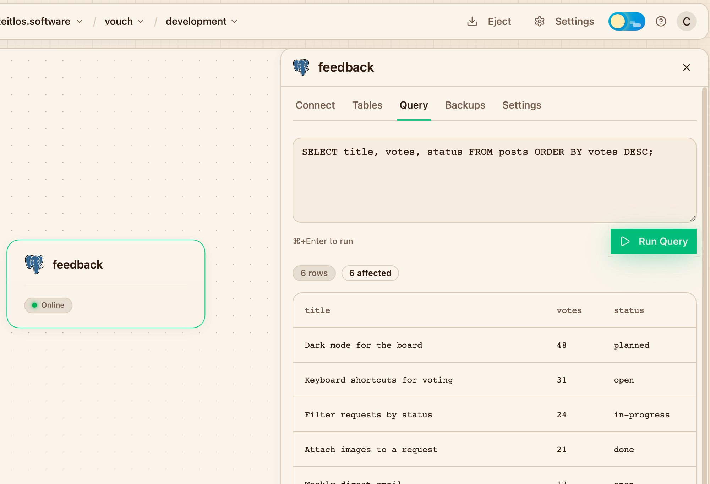
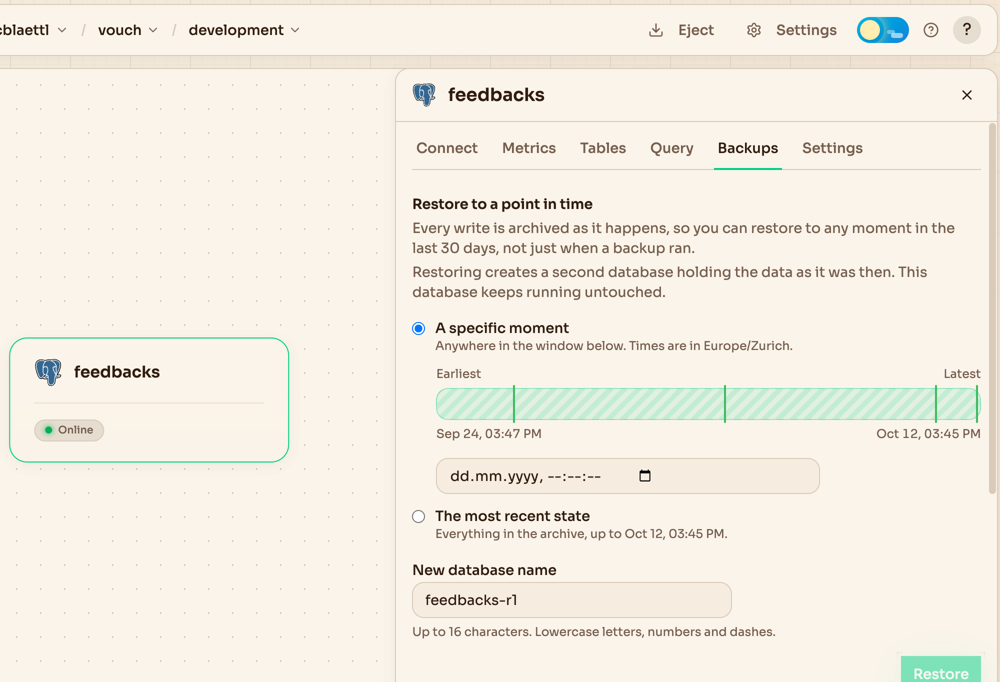
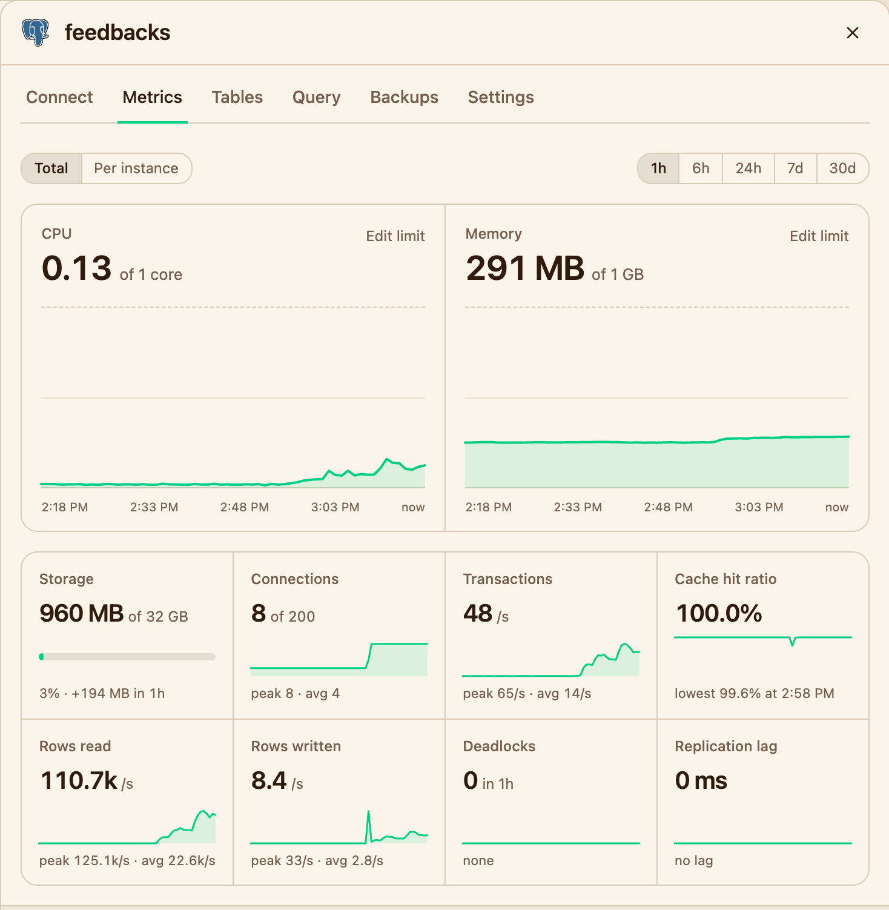
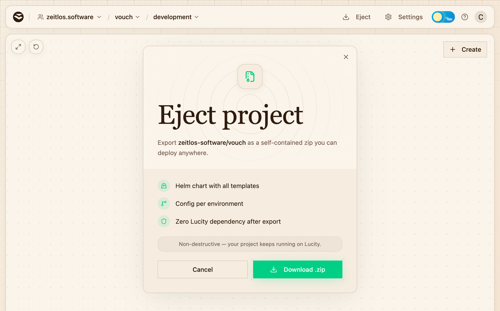

  <picture>
    <source media="(prefers-color-scheme: dark)" srcset="assets/logo-dark.svg">
    
  </picture>

  The Deployment Platform that is a joy to use, built to grow, and always yours to keep.

  Lucity is an open-source Vercel/Railway/Heroku alternative deliberately designed to avoid lock-in. Push to deploy, one-click PostgreSQL, Redis and object storage.

  
  
  

  

<table>
  <tr>
    <td width="50%" valign="top">
      
      
<b>Push to deploy.</b> Builds straight from your repo, no Dockerfile needed. <a href="https://lucity.cloud/docs/quickstart">Quickstart</a>

    </td>
    <td width="50%" valign="top">
      
      
<b>Wire services together.</b> Reference database and bucket credentials instead of copying them. <a href="https://lucity.cloud/docs/variables">Variables</a>

    </td>
  </tr>
  <tr>
    <td width="50%" valign="top">
      
      
<b>Managed PostgreSQL.</b> Browse tables and run queries right in the dashboard. <a href="https://lucity.cloud/docs/postgres">PostgreSQL</a>

    </td>
    <td width="50%" valign="top">
      
      
<b>Point-in-time restore.</b> Every write is archived, so you can rewind to any moment in the last 30 days.

    </td>
  </tr>
  <tr>
    <td width="50%" valign="top">
      
      
<b>Metrics and logs built in.</b> CPU, memory, storage and connections at a glance. <a href="https://lucity.cloud/docs/metrics">Metrics</a>

    </td>
    <td width="50%" valign="top">
      
      
<b>Eject anytime.</b> Download your project as a plain Helm chart and run it without Lucity. <a href="https://lucity.cloud/docs/eject">Eject</a>

    </td>
  </tr>
</table>

## Documentation

Full documentation at **[lucity.cloud](https://lucity.cloud)**.

## Lucity Cloud

Don't want to run your own infrastructure? **[Lucity Cloud](https://lucity.cloud/)** is the managed version of Lucity.

## Built by zeitlos

Lucity is made by [zeitlos.software](https://zeitlos.software), a Swiss software company.

## Contributing

This project is still relatively early stage, but if you want to contribute, see [CONTRIBUTING.md](CONTRIBUTING.md) for development setup, architecture overview, and how to get started.

## License

[AGPL-3.0](LICENSE)
